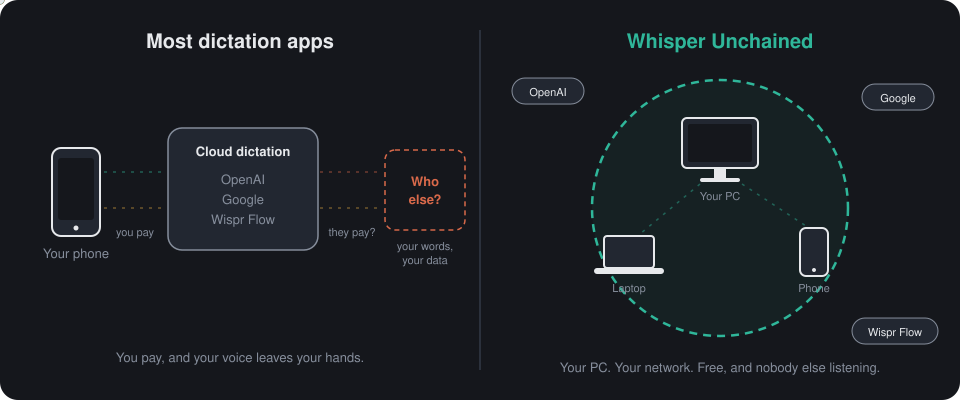
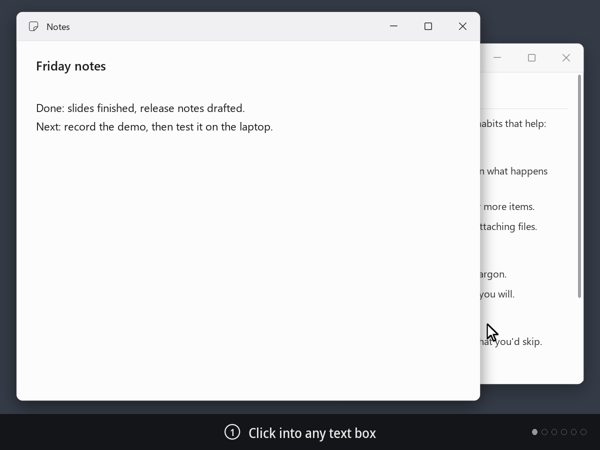
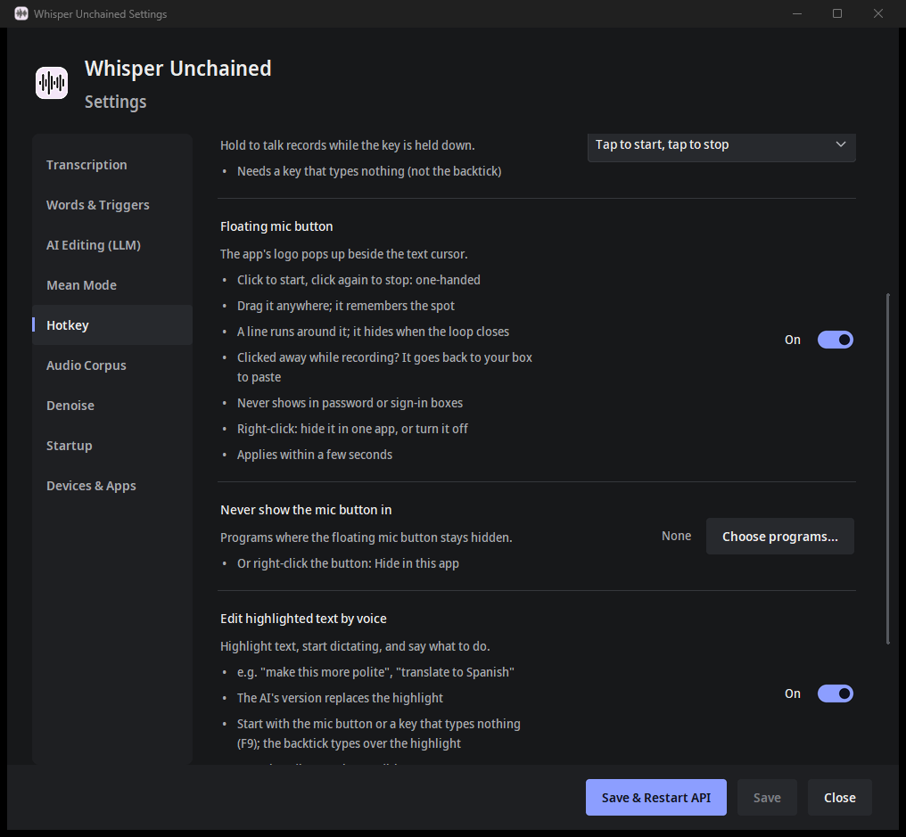
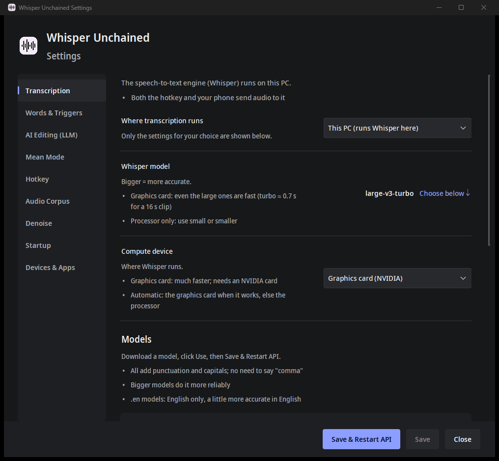
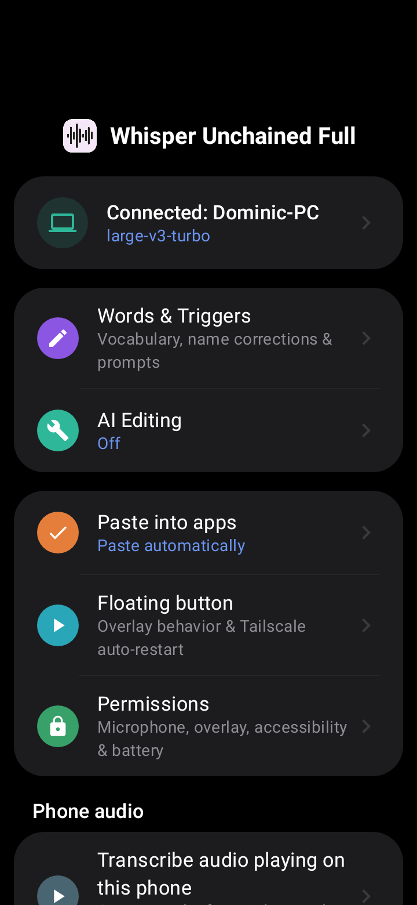
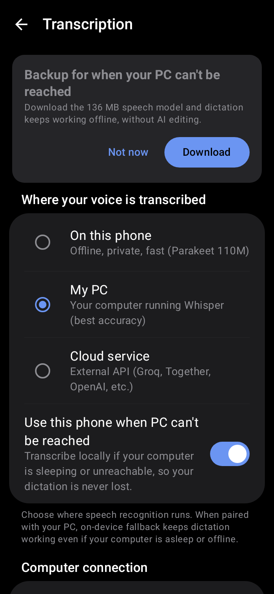

# Whisper Unchained

**Free, open-source dictation for Windows and Android that runs on your own hardware.** Talk, and the text lands where your cursor is: punctuated, names spelled right, and never sent to anyone else's servers unless you choose a cloud service.

<p align="center">
  
</p>

**I know there are a thousand of these. Here's why I built this one:** I wanted my phone, my laptop and my powerful PC to work the same way. Same button, same word list, same AI editor: change it in one place and they all pick it up. All free, all running the same software, and the phone never loses a dictation: if the PC can't be reached, it transcribes on the phone or keeps the recording and retries.

<p align="center">
  
  <br />
  <b>Windows 10/11 and Android.</b> Shown here on Windows; the same button and style pill are on the phone.
</p>

## What's different

- **The first desktop mic button you can drag, with the dictation style right on it.** Click into any text box on Windows and the button pops up at your cursor: click to talk. While you talk, the style pill sits under it. A ring counts down before it gets out of the way, it never shows in password boxes, and you can hide it per app. Same button on your phone.
- **The first to put one server of your own behind both a Windows dictation app and an Android app.** Your PC's graphics card does the work for your phone and your laptop too: at home or anywhere over Tailscale, encrypted HTTPS locked to your PC with a QR code, an API key if you want one, and the same server open to your other apps (OpenAI-compatible `/v1/audio/transcriptions`). Any device can also run on its own, or on your own cloud key (Groq, OpenAI, ...).
- **Quickly change the style for one dictation.** Swipe the pill while you talk, or tap it for the full menu: keep my words / fix grammar / polish, shorter, punctuation, tone. The next dictation is back to your defaults.
- **It pastes where you started.** Clicked into another window before pressing stop? It brings the original window back, puts the cursor exactly where it was and pastes there. If it can't, the text waits on your clipboard with a clear notice, never in the wrong place.
- **Talk to your own AI mid-sentence:** *"...the meeting moved to noon. Prompt AI, make this formal."* Your own model does it (Ollama, LM Studio, llama.cpp, vLLM, ...), found on your network automatically. I use Bonsai2 27B; Qwen2.5 7B Instruct fits next to Whisper in 16 GB, and the app suggests models down to about 4 GB for smaller cards.
- **Highlight text and say what to do with it** ("make this more polite"), and **per-app styles** (casual in Slack, exact in a terminal): the paid apps' headline features, free and on your own hardware.
- **Game mode:** frees your graphics card while a full-screen game runs, and comes back when you stop.
- **Mean mode,** for fun: say "prompt roast" and your rant comes back as a witty reply, with a line from a curated insult bank.

## Plus everything the others have

- **Free and open source (MIT).** No account, no subscription, no telemetry. API keys are stored encrypted.
- **Private by default:** nothing leaves your PC unless you pick a cloud service.
- **The right model for your hardware,** picked automatically from tiny to large-v3-turbo, with or without a graphics card. Change it any time.
- **Punctuation and capitals on their own,** without saying "comma".
- **Optional AI cleanup:** drops the um's and uh's, keeps "Tuesday, no wait, Wednesday" as Wednesday, and follows spoken "new paragraph", "slash" and "quote unquote".
- **Your words, spelled right:** a vocabulary plus corrections and shortcuts ("my email address" types your address), shared by the PC and the phone.
- **Talk as long as you like,** with no flickering live text to break your train of thought.
- **A hotkey** (F9 by default; tap or hold to talk), a history of recent dictations, right-click "Transcribe" for audio and video files, and many languages with the multilingual models.
- **A one-click Windows installer** with its own private Python. It touches nothing else on your PC, and uninstalls cleanly. It also works inside Chrome Remote Desktop.
- **And it's fast:** faster than typing. On an RTX 2070 Super, 16 seconds of talking comes back in about 0.7 s.

## Screenshots

| Windows | | Android | |
| :---: | :---: | :---: | :---: |
|  |  |  |  |
| The floating mic button's settings | Where Whisper runs, and the model | Home: paired with the PC | On the phone, your PC, or the cloud |

## Download

| | |
| :--- | :--- |
| **Windows PC** (the server, hotkey and tray app) | [Whisper Unchained Server installer (.exe)](https://github.com/Dominic-Shirazi/Whisper-Unchained-Server/releases) |
| **Android phone** | [Whisper Unchained for Android (.apk)](https://github.com/Dominic-Shirazi/Whisper-Unchained-Android/releases/latest) · [source code](https://github.com/Dominic-Shirazi/Whisper-Unchained-Android) |

Both are early preview builds and aren't code-signed yet: if Windows shows "Windows protected your PC", click **More info**, then **Run anyway**; Android asks you to allow installing from your browser. Not available (yet) for Mac, iPhone or the Linux desktop; the server also runs on Linux ([what works where](docs/PLATFORM_DIFFERENCES.md)).

## Where the speech recognition runs

Pick one in the installer, change it any time in Settings:

| | Where Whisper runs | Good for |
| :--- | :--- | :--- |
| **On this PC** | Your own graphics card (or processor). Nothing leaves your PC. | Privacy, no costs. The installer picks the best model for your card. |
| **On another PC of yours** | A PC in your home already running Whisper Unchained Server. | Laptops and small PCs: the big PC does the work. |
| **A cloud service** | Groq, OpenAI or any OpenAI-compatible service, with **your own** API key. | No graphics card at all. (The audio does leave your PC in this mode.) |

## How it started

I got sick of poor transcription tools, and I was tired of manually dictating punctuation. Worse: watching words appear on-screen in real-time broke my train of thought, especially when a word was mistranscribed.

I just wanted a tool where I could hit a button, "word vomit" my thoughts into a text field, and hit Enter—without being distracted by the transcription process. This tool is designed to be completely invisible until it drops the finished, perfectly punctuated text.

<p align="center">
  
  
</p>

With the `large-v3-turbo` model on an RTX 2070 Super and a $12 used USB microphone, it's _dang near perfect_: long pauses and punctuation are handled for you, a 16-second clip comes back in about 0.7 s and a 72-second one in about 2 s, using about 2.1 GB of video memory. Smaller graphics cards and PCs without one get a smaller model automatically (you can change it in Settings > Transcription).

## Voice triggers

Triggers are detected by the server, so they work from every client (desktop hotkey, Android app, right-click "Transcribe to Clipboard"). Edit them in Settings > Words & Triggers.

| Say | What happens |
|---|---|
| `prompt ai` + instructions | Everything before the trigger is the text; everything after is the instruction. Your AI model (Settings > AI Editing) edits the text accordingly. Bare `prompt ai` with no instruction just cleans the text up. Misheard variants like "prompt A.I.", "prompt a eye" and "prompte I" also match. |
| `end prompt` | Optional terminator that marks the end of a spoken instruction. |
| `prompt mean mode` / `prompt roast` / `prompt tiktok` (or "tick tock") / `prompt disses` | Mean mode: rewrites your brain-dump as a social-media reply with a matching insult from `insults.md`. |
| `tag this clip`, `loud in here`, `restaurant test`, `outdoor test`, `crowd test`, `loud` | Files the audio permanently in `api/audio_corpus/keep/` for model testing. Your transcript is unchanged. Edit the list with `CORPUS_TAG_TRIGGERS` in `.env`. |

Not spoken triggers, but always on: corrections and shortcuts (say "my email address", get your address) and the vocabulary (words Whisper is nudged to spell correctly), both in Settings > Words & Triggers. Optional AI cleanup (fillers, "no wait" corrections, spoken "new paragraph") is in Settings > AI Editing.

## Installation

### Easy way (Windows)

1. Download the **Whisper Unchained Server setup (.exe)** from [Releases](https://github.com/Dominic-Shirazi/Whisper-Unchained-Server/releases) and run it. It installs into your own user folder (no admin needed for this part) and adds Start-menu entries.
2. Leave **Finish setup now** ticked. You don't need Python or CUDA installed first:
   - it downloads [uv](https://github.com/astral-sh/uv) (pinned, checksum-verified) and uses it to install a private copy of Python inside the app folder;
   - installs the packages at the exact versions in `constraints.txt`;
   - on a PC with an NVIDIA card, installs NVIDIA's CUDA libraries into the same environment (no CUDA Toolkit needed).
3. The setup wizard opens. Pick **Use recommended settings** (it looks at your graphics card and picks the model) or **Walk me through the settings**. It also looks for AI servers you already run (Ollama, LM Studio, ...) and, if other devices will use this PC, offers Tailscale.
4. Click **Install**. Windows asks once for permission, to set up the background server and let your phone reach it on your home network and Tailscale. The wizard downloads the model, installs the server as a Windows service, starts the tray app, and checks everything answers.

Prefer git? Clone this repository and double-click **`Setup.bat`**: same steps from 2 on.

Running setup again later (Start menu > **Repair or change setup**, or `Setup.bat`) repairs or updates the install and keeps your settings. Logs are in `installer/logs/`. Uninstall from Windows Settings > Apps; it asks before deleting your settings, transcripts and models.

Requirements: Windows 10/11, about 3 GB of disk space, and an NVIDIA GPU with 4 GB+ of video memory for the recommended model (smaller cards and CPU-only PCs get a smaller model automatically).

### Manual way

```powershell
python -m venv .venv
.\.venv\Scripts\Activate.ps1
pip install -r requirements.txt -c constraints.txt
copy .env.example .env      # then edit, or use the Settings window
```

Then run the setup wizard (`.venv\Scripts\pythonw.exe installer\wizard.py`): it installs the background server and everything else, just like the easy way.

### Linux (headless)

The server runs on Linux too (tested on Ubuntu 24.04 with two RTX 2070 Supers). This is the server only, for the phone app and other PCs; the hotkey, tray and Settings window are Windows-only for now.

```bash
git clone https://github.com/Dominic-Shirazi/Whisper-Unchained-Server.git
cd Whisper-Unchained-Server
sudo scripts/install_linux.sh        # system service, runs as its own user
# or, without root:
scripts/install_linux.sh --user      # systemd --user service, runs as you
```

The script:

- creates `.venv` and installs `requirements.txt` with the `constraints.txt` pins;
- with an NVIDIA driver, installs NVIDIA's CUDA 12 cuBLAS and cuDNN 9 libraries into the venv (no CUDA Toolkit needed), picks the GPU with the most free memory, and uses `float16` if it has 2.6 GB free, `int8_float16` (about 1.2 GB) if it has 1.4 GB, else the CPU. `--gpu N` or `--gpu cpu` overrides;
- writes `.env` from `.env.example` with HTTPS on and a new API key (re-running keeps your key and settings). It also sets `OLLAMA_EDIT_PRELOAD=false`, so the server doesn't pin an edit model in a shared Ollama at every start;
- uses port 5000, or the next free one (`--port N` to choose);
- installs and starts the `whisper-unchained` systemd service and waits until `/health` says ok. The first start downloads the model into `models/`.

The system service runs as the `whisper-unchained` user, so that user must be able to read the folder: clone into `/opt` or similar, not a private home folder (the script checks). The `--user` service only starts at boot after `sudo loginctl enable-linger $USER`.

Pair a phone:

```bash
.venv/bin/python -m client.pair      # QR in the terminal, plus the text
```

It uses this machine's Tailscale address, else its LAN address (`--host` to choose). The text contains your API key, so don't paste it anywhere public.

Check and manage it:

```bash
curl -k https://127.0.0.1:5000/health
systemctl status whisper-unchained          # --user service: systemctl --user status whisper-unchained
journalctl -u whisper-unchained -f          # --user service: journalctl --user -u whisper-unchained -f
```

If a firewall is on (`ufw status`), allow the port from your network and Tailscale, for example `sudo ufw allow in on tailscale0 to any port 5000 proto tcp`.

## How to Transcribe

- **Action**: press the hotkey to start recording and press it again to stop. The default is the backtick (`` ` ``, the key under Esc that nobody uses); pick another key, or hold-to-talk, in Settings > Hotkey.
- **Result**: the audio is transcribed and the text is pasted wherever your cursor is. With the backtick, the two `` ` `` it typed are deleted first.

---

## Windows Integration

**Right-click "Transcribe to Clipboard"**: right-click any audio or video file in File Explorer to copy its text. The installer adds it (a switch on its Install page), and Settings > Startup > Windows integration has Add/Remove buttons for it and for "Start when I log in". Neither needs admin rights.

---

## API Endpoints

The server listens on port `5000` by default (Settings > Startup). Every `POST` endpoint that transcribes takes the audio as the multipart field `file`, and all of them share the same loaded Whisper model.

| Endpoint | Method | Returns | Good for |
| --- | --- | --- | --- |
| `/v1/audio/transcriptions` | POST | **OpenAI-compatible**: `file`, optional `prompt`, `language`, `response_format` = `json` / `text` / `verbose_json` (`model` is accepted and ignored). Extra fields: `processing` = `full` (default: voice commands), `raw` (Whisper's text untouched) or `clean` (also run AI cleanup), plus `cleanup_*` style overrides. Errors use OpenAI's `{error: {message, type, code}}` shape. | Any app or script that already speaks OpenAI's API: point it at `http://<your PC>:5000/v1`. |
| `/v1/models` | GET | `{object: "list", data: [{id: <loaded model>}]}` | Checking the server is up and your key works. |
| `/v1/vocabulary` | GET / POST | The shared word list; POST `{"add": [...]}` adds words (add-only) | Keeping the phone's and the PC's vocabulary in sync. |
| `/v1/pause`, `/v1/resume` | POST | Frees / reloads the graphics card memory | Game mode and the tray's pause; scripts that need the GPU for a while. |
| `/transcribe` | POST | `{text, language, duration}` | The desktop hotkey's endpoint (same pipeline as `/v1/audio/transcriptions`). |
| `/transcribe_time_stamped` | POST | `{text, segments[{start, end, text}], language, duration}`: Whisper's text with segment times, no AI rewriting | Subtitles and captions, or jumping to a sentence in a recording. |
| `/transcribe_words` | POST | Same, plus `words[{start, end, word, probability}]` on each segment | See below. |
| `/health` | GET | `{status: ok / paused / error, model, auth_required, ...}`. Never needs a key. | Monitoring; the phone app's connection check. |
| `/warmup` | POST | Preloads the Ollama edit model | Avoiding a slow first "prompt AI" after a restart. |

```bash
curl -F file=@clip.wav -F response_format=text http://127.0.0.1:5000/v1/audio/transcriptions
```

**API key (optional).** Off by default, which is fine on your own home network and Tailscale. To require one, press **Generate** in Settings > Devices & Apps and Save & Restart API; the phone gets the key by scanning the pairing QR code. Clients then send `Authorization: Bearer <key>` on every route except `/health`. (It's stored as `WHISPER_API_KEY` in `.env`, if you script against the server.)

The app-facing contract (shared with the Whisper Unchained Android app) is `contracts/01-transcription-api.md` in [Whisper-Unchained-Android](https://github.com/Dominic-Shirazi/Whisper-Unchained-Android).

### Word-level timestamps (`/transcribe_words`)

The time each word was spoken, which other projects can build on:

- **Phone calls and meetings:** record each side on its own channel, transcribe both, then interleave them word by word into one conversation. (Whisper often merges speech across a pause into one long segment; word times let you split at the pauses.)
- **Karaoke-style captions** that highlight each word as it's spoken, or subtitles cut at natural pauses.
- **Audio editing and search:** cut a recording exactly at a word, or jump to where someone said a name.
- **Spotting shaky words:** each word's `probability` shows where Whisper was unsure.

Notes:

- Decode settings match `/transcribe_time_stamped` (beam 5, voice detection, no previous-text conditioning, same vocabulary hints), with word timestamps added.
- Segment `start`/`end` are snapped to the first and last word, so they're tighter than on `/transcribe_time_stamped`. On long clips (over about a minute), the segment split and sometimes the wording can differ a little. Treat the word times as the source of truth.
- Whisper sometimes folds a pause into the word before it (one word with an unusually long duration) instead of leaving a gap. When splitting, check for long words as well as gaps.
- Transcript text is never logged.

## Project Files

- `api/`: the transcription server (`whisper_api.py`), AI cleanup and voice-command rules (`cleanup.py`, `edit_commands.py` and their prompt files).
- `client/`: the tray app and hotkey listener (`listener_watchdog.py`, `background_listener.py`), the Settings window (`settings_gui.py`), phone pairing (`pairing.py`, and `pair.py` for a terminal), and the right-click helper (`transcribe_file.py`).
- `installer/`: `Setup.bat`'s bootstrap, the setup wizard, and the `.exe` build (`build_exe.ps1`, `WhisperUnchained.iss`).
- `scripts/`: the service, login-start and right-click-menu installers (each also takes `-Remove`). `scripts/install_linux.sh` installs the server on Linux.
- `.env`: your settings (written by the Settings window). `api/processing_config.json`: your vocabulary, name corrections and triggers.

---

## Troubleshooting

### My phone (or another PC) can't reach the server

- **Same Wi-Fi:** the installer opens the server's port in Windows Firewall for your home network and Tailscale. If you installed manually, re-run setup (Start menu > Repair or change setup) to add that rule.
- **Away from home:** your phone needs a way to find your PC over the internet. [Tailscale](https://tailscale.com) is the easy, free way (install it on both, same account, then re-pair the phone so it gets the Tailscale address). A static IP with port forwarding works too.
- **Check:** open `http://<your PC's address>:5000/health` in the phone's browser. If you see `"status":"ok"`, the app will connect.

### Pasting into Chrome Remote Desktop (or other remote sessions)

If you run the listener on your **local** machine but dictate into an app inside a **Chrome Remote Desktop** window, a plain clipboard paste used to fail — it would either paste nothing or paste the remote machine's _old_ clipboard.

This is a Chrome Remote Desktop quirk, not a bug in this tool: CRD only pushes your local clipboard to the remote machine on a window **focus-in** event, and only for a "real" copy. A silent, programmatic clipboard write doesn't trigger the sync, so `Ctrl+V` pastes whatever stale text the remote already had.

**The listener handles this automatically.** Before pasting it copies the text from a real (off-screen, invisible) window and briefly bounces window focus, which is exactly the event CRD needs to sync the clipboard across. You may notice a tiny screen flicker as focus leaves and returns — that flicker _is_ the sync happening.

**If it still pastes stale text** (slow or laggy connections), give the sync more time. In your `.env`:

```
# Seconds to wait for the clipboard to reach the remote machine before pasting.
# Raise this on slow connections (e.g. 1.0 or 1.5).
CRD_SYNC_DELAY_SECONDS=0.6
```

**If it pastes a plain "v"** instead of your text, the remote side saw the V before the Ctrl. The listener holds Ctrl a moment around the V (40 ms gaps); on a laggy connection raise `PASTE_KEY_GAP_SECONDS` in `.env` (e.g. `0.08`), then restart the listener from the tray.

---

## History

**_UPDATE_**
Added feature: say 'prompt ai' followed by instructions and it will use Ollama (or other local LLM) to edit the text per your instructions.

Potential use: _hit record_ "The movie is Wednesday, I mean Tuesday, actually... Thursday at noon... Prompt AI, can you make that clear about it being Thursday?" _hit stop_ -> outputs -> "The movie is Thursday at noon."

**_UPDATE 2_**
Added Feature: Android app - local open source version of wispr flow with a floating button to press to record and press to stop. Record as long as you want with no pressure to keep going before it cuts you off. Also works with the 'prompt ai' feature.

**_UPDATE 3_**
Added feature: say 'prompt ai roast' / 'prompt roast', 'prompt tiktok' (also recognized as 'tick tock'), or 'prompt disses' to trigger a shared **mean mode** editor. It takes your dictated brain-dump, works out the reasoning flaw the other person is making, reorganizes your thoughts into a tight social-media-ready reply in your own voice (plain text, no em-dashes), and weaves in a matching witty insult. Insults live in `insults.md` in the root directory, grouped by the kind of reasoning failure they target so the AI can pick one that actually fits, you can add your own under any heading over time.

Mean mode works with any AI server (Settings > Mean Mode): Ollama, the same server as AI Editing, or any OpenAI-compatible server or cloud. A model that won't refuse helps; the default is `huihui_ai/qwen2.5-abliterate:7b` (pull it once with `ollama pull huihui_ai/qwen2.5-abliterate:7b`). Because triggers are detected server-side, this works from the Android app and any other client with no changes.

**_UPDATE 4_**
Added feature: Automatic Ollama LLM warmup at startup. When the API service starts or restarts, it asynchronously preloads your configured Ollama editing model (e.g. `qwen2.5:7b-instruct-q4_K_M`) with `keep_alive` enabled, keeping it resident in GPU VRAM alongside Faster-Whisper so voice edits execute in under a second without cold-start delay.

## Acknowledgments and Attributions

This project relies on several fantastic open-source libraries:

- [Faster-Whisper](https://github.com/SYSTRAN/faster-whisper) (MIT License) - Core transcription engine.
- [FastAPI](https://github.com/tiangolo/fastapi) (MIT License) - Web framework for the API.
- [Uvicorn](https://github.com/encode/uvicorn) (BSD 3-Clause) - ASGI web server.
- [NSSM - the Non-Sucking Service Manager](http://nssm.cc/) (Public Domain) - Used for background Windows Service management.
- [Requests](https://requests.readthedocs.io/) (Apache 2.0) - HTTP library.
- [Keyboard](https://github.com/boppreh/keyboard) & [SoundDevice](https://github.com/spatialaudio/python-sounddevice) (MIT License) - Hotkey and audio capture integration.
- Other helpful libraries including `numpy`, `scipy`, `pyperclip`, `pywin32`, and `python-dotenv`.
